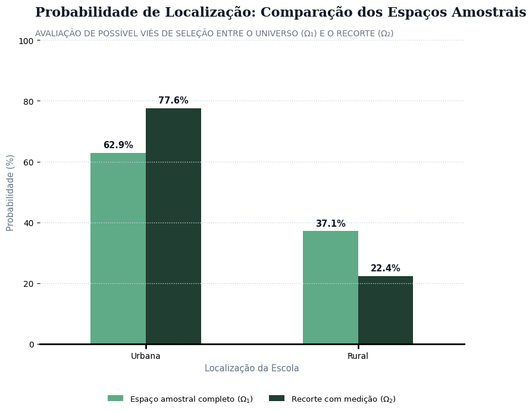
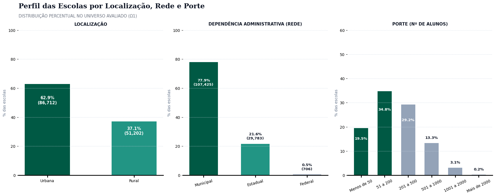
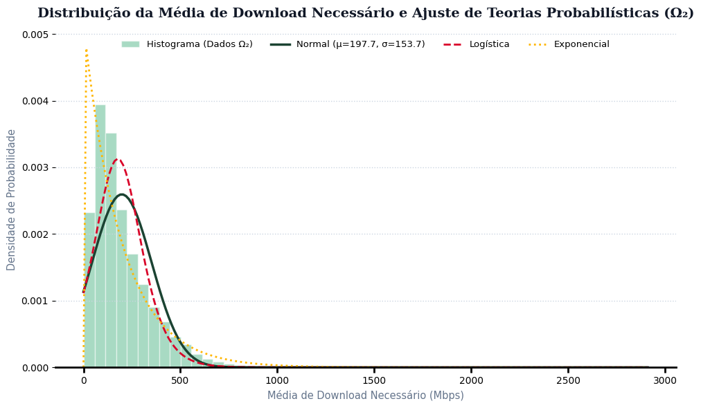
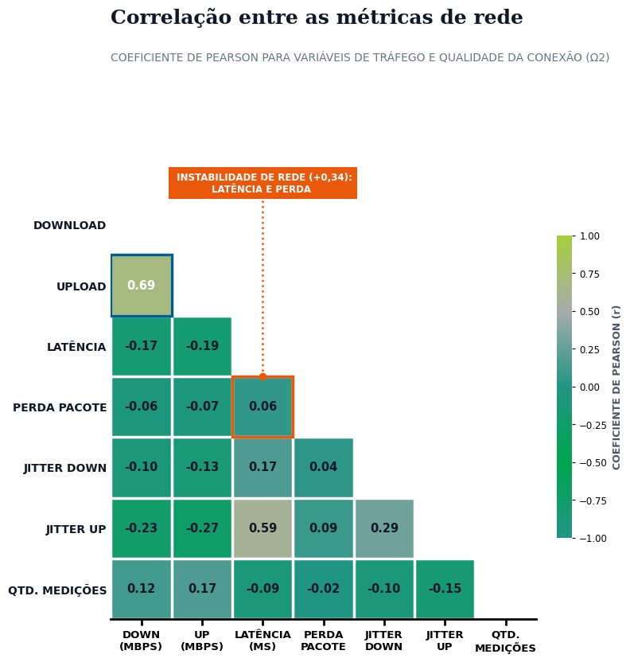
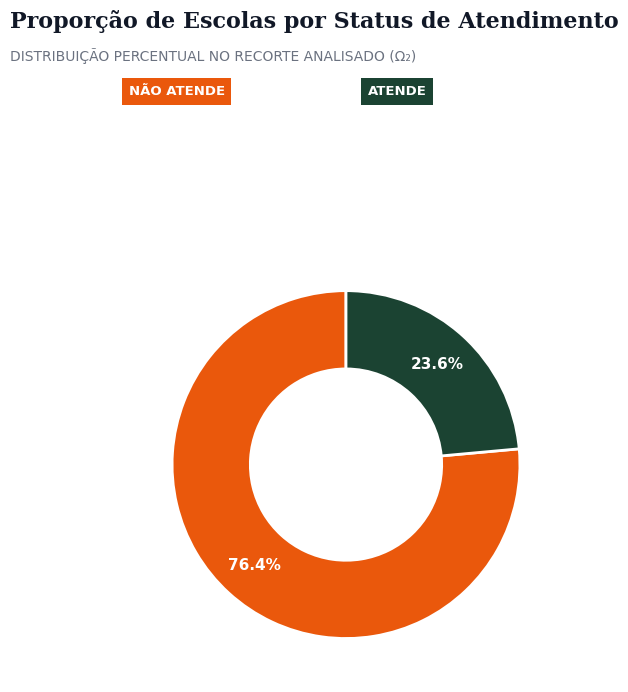

# EduConectada: Diagnostico Estatistico da Conectividade nas Escolas Publicas Brasileiras

> **Language / Idioma:** [English](README_en.md) | **Portugues**


> **Resumo Executivo:** Este projeto analisa a infraestrutura de internet nas escolas publicas de educacao basica do Brasil a partir da base **EduConectada (137.914 escolas)** e das medicoes ativas de trafego do medidor **SIMET (76.359 escolas com medicoes validas)**. Combinando analise exploratoria, espacos amostrais (Ω1 e Ω2), probabilidade condicional, funcoes de distribuicao acumulada e simulacao do **Teorema Central do Limite**, o estudo responde a questoes criticas de infraestrutura: **existe diferenca na qualidade de conexao entre escolas urbanas e rurais, e a velocidade entregue atende a demanda estimada para os estudantes?**

---

## 1. Contexto e Delimitacao dos Espacos Amostrais (Ω1 vs. Ω2)

Ao auditar as **137.914 escolas** da base (comparadas com o Censo Escolar), constatou-se que variaveis cadastrais (localizacao, rede, porte e matriculas) possuem cobertura quase integral, enquanto as medicoes empíricas de rede estao disponiveis apenas para um subconjunto de unidades. 

Para viabilizar a analise do proprio objeto de estudo — a conexao real e a qualidade do trafego de internet —, foram estruturados dois espacos amostrais:

- **Ω1 (137.914 escolas):** Universo cadastral completo para analise de infraestrutura fisica, distribuicao geografica e presenca declarada de internet (`indicador_internet`).
- **Ω2 (76.359 escolas):** Subconjunto de escolas com internet declarada e medicao valida de desempenho TCP via SIMET (`media_tcp_download`, `media_tcp_upload`, `media_latencia`, `media_jitter_upload`). 

> **Nota metodologica sobre vies de selecao:** A delimitacao de Ω2 nao teve como objetivo eliminar vieses, uma vez que a presenca de medidores ativos pode concentrar escolas com melhor infraestrutura preexistente. A segmentacao foi desenhada para permitir investigar empiricamente o comportamento do trafego de dados onde ha medicao real.





---

## 2. Principais Descobertas Estatisticas

### A. Assimetria Positiva e o Comportamento da Velocidade

As distribuicoes de download e upload apresentam **forte assimetria positiva (cauda longa a direita)**. Poucas escolas com links de altissima velocidade puxam a media aritmetica para cima, tornando a **mediana** o parametro estatistico mais representativo da escola tipica brasileira.



Alem disso, observa-se forte associacao linear positiva entre download e upload ($r = 0.69$), com dispersao em leque, e acentuada correlacao entre latencia e jitter.




---

### B. O Paradoxo Urbano vs. Rural (Probabilidade Condicional)

#### 1. Velocidade Bruta (Mbps)
Em termos nominais brutos, as escolas **urbanas** registram uma velocidade mediana de download equivalente ao **dobro** da mediana observada nas escolas **rurais**.


#### 2. Atendimento a Demanda Estimada por Estudante
Cruzando a velocidade medida com a velocidade recomendada (estimada para suportar transmissao simultanea de video para 50% dos alunos matriculados, proporcional ao porte da escola), **76,4% das escolas analisadas nao atendem a demanda minima estimada**.



#### 3. O Paradoxo de Atendimento
Ao calcular a **probabilidade condicional** de atendimento dentro de cada regiao:
- **P(Atende | Rural) = 30,17%**
- **P(Atende | Urbano) = 21,64%**

A probabilidade de uma escola rural ter banda suficiente para atender a sua comunidade escolar e superior a de uma escola urbana.


#### Por que isso acontece?
A explicacao reside na distribuicao acumulada de porte escolar. Escolas urbanas concentram volumes substancialmente maiores de matriculas. Mesmo recebendo links com velocidade nominal maior, a divisao da banda pela quantidade de estudantes resulta em deficit per capita com frequencia maior do que nas escolas rurais, que possuem contingentes reduzidos de alunos.


---

## 3. Teorema Central do Limite (Simulacao de Amostragem)

Utilizando a variavel `media_tcp_download`, foi realizada a simulacao computacional de convergencia das medias amostrais para tamanhos crescentes ($n = 1 \rightarrow n = 30 \rightarrow n = 100 \rightarrow n = 500$). 

A simulacao evidencia empiricamente que, a medida que o tamanho da amostra aumenta, a distribuicao das medias amostrais converge para o formato gaussiano (normal), reduzindo a variancia na razao direta do desvio padrao dividido pela raiz de $n$, exatamente como postulado pelo Teorema Central do Limite.

---

## 4. Estrutura do Repositorio

```text
educonectada-school-connectivity/
├── README.md                            # Documentacao metodologica e analitica (Portugues)
├── README_en.md                         # Methodology and analytical findings (English)
├── notebooks/
│   └── educonectada.ipynb               # Notebook Python com todas as analises e simulacoes
└── reports/
    └── figures/                         # Graficos e visualizacoes do estudo em alta resolucao
```
