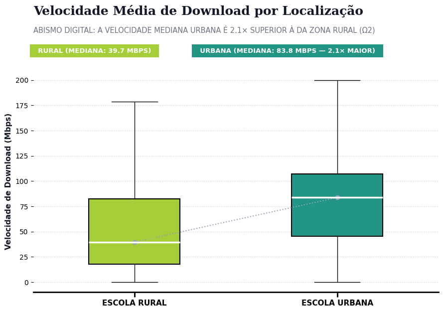
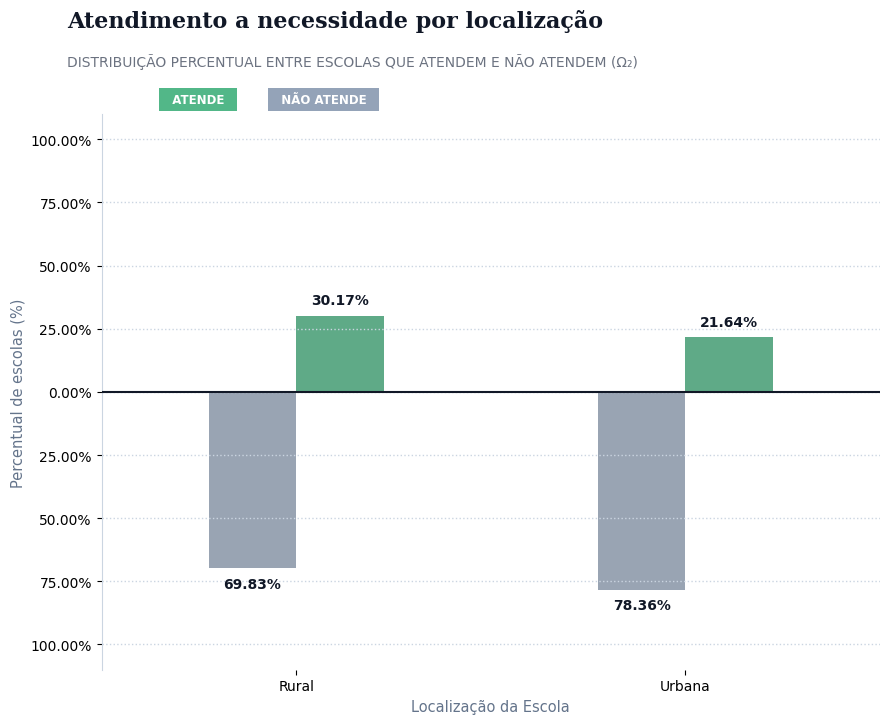
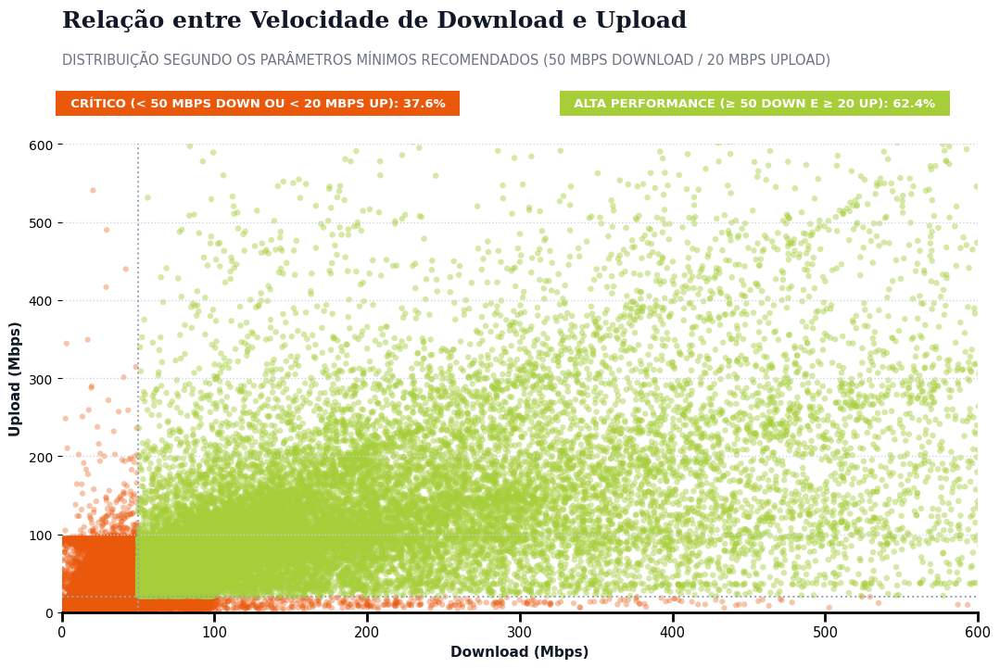
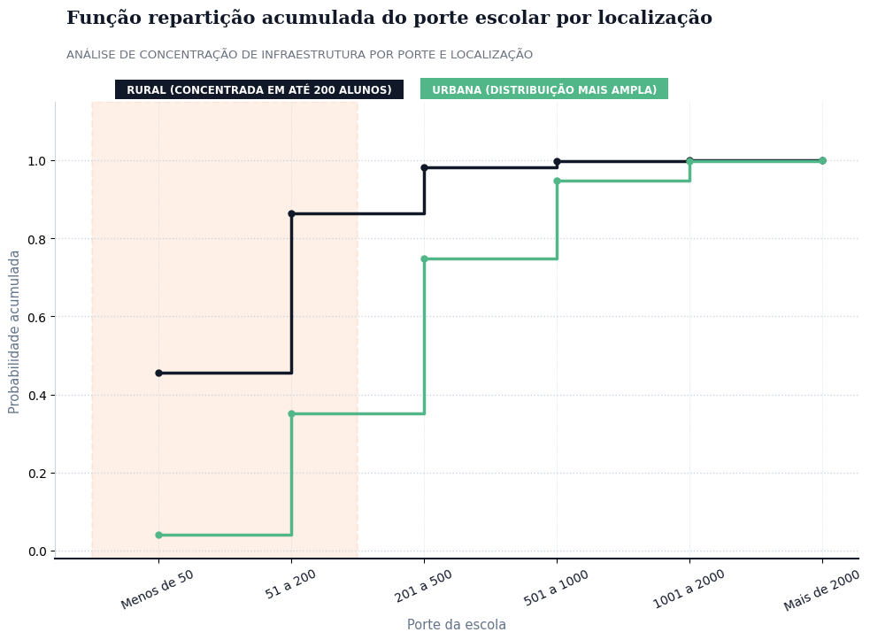

# 🏫 EduConectada: Statistical Assessment of Internet Connectivity in Brazilian Public Schools

> 🌐 **Language / Idioma:** **English** • [Português](README.md)


> **Executive Summary:** This study evaluates real-world internet connectivity across Brazil's public basic education schools, drawing from the nationwide **EduConectada registry (137,914 schools)** and active network telemetry from **SIMET (~77,000 schools)**. Combining sample space stratification ($\Omega_1$ vs. $\Omega_2$), conditional probability modeling, cumulative distribution functions, machine learning feature scaling (`StandardScaler` vs. `MinMaxScaler`), and **Central Limit Theorem (CLT)** empirical simulation, this research investigates a pivotal public policy question: **is the measured bandwidth delivered to public schools sufficient to meet per-student educational demand?**

---

## 📊 Visual Analysis Preview

| Bandwidth Distribution (Urban vs. Rural) | Fulfillment Paradox (Conditional Probability) |
| :---: | :---: |
|  |  |

| Download vs. Upload Dynamics (TCP Telemetry) | Cumulative Probability by School Size |
| :---: | :---: |
|  |  |

---

## 1. Context & Sample Space Stratification ($\Omega_1$ vs. $\Omega_2$)

When auditing the **137,914 schools** in the registry (benchmarked against ~136,700 active public schools in the 2025 Basic Education Census), administrative variables (location, administrative network, enrollment size, computer labs) showed near-universal coverage, whereas empirical network measurements from the **SIMET** meter were available for an active subset. To eliminate analytical bias, two distinct sample spaces were defined:

- **$\Omega_1$ (`137,914 schools`):** Complete administrative universe for physical infrastructure, geographic distribution, and declared internet access (`indicador_internet`).
- **$\Omega_2$ (`~77,000 schools`):** Subpopulation of connected schools with active TCP performance telemetry via SIMET (`media_tcp_download`, `media_tcp_upload`, `media_latencia`, `media_jitter_upload`).

---

## 2. Core Statistical Findings

### A. Positive Skewness & The Limitation of Unweighted Averages
- Both `media_tcp_download` and `media_tcp_upload` exhibit **heavy right-skewed distributions (long right tails)** (`fig_04_distribuicao_cauda_longa_download.png`). A small fraction of schools equipped with high-capacity fiber links inflates the arithmetic mean, obscuring the bandwidth constraints faced by the median school.
- Strong positive correlation between download and upload speed ($r = 0.69$), displaying diagonal heteroscedastic fan dispersion (`fig_03_relacao_download_upload.png`), alongside tight coupling between latency and jitter (`fig_02_matriz_correlacao_metricas.png`).

### B. The Urban-Rural Paradox (Conditional Probability)
1. **Raw Bandwidth (Median):** Urban schools register a median download speed roughly **twice as high** as rural schools (`fig_05_velocidade_urbana_vs_rural.png`).
2. **Per-Student Demand Fulfillment (`diferenca_download`):** When contrasting delivered throughput with `velocidade_download_necessaria` (modeled to allow 50% of enrolled students to stream concurrent instructional video):
   - The overwhelming majority of Brazilian schools **fail to meet** estimated pedagogical demand (`fig_06_velocidade_necessaria_vs_entregue.png`).
   - Evaluating conditional probability ($P(\text{Sufficient} \mid \text{Location})$) uncovers a counterintuitive finding: **30.17% of rural schools meet estimated demand, compared to only 21.64% of urban schools** (`fig_07_paradoxo_atendimento_urbano_rural.png`).
   - **Underlying Mechanism:** Although urban schools receive higher aggregate Mbps links, they host substantially larger student bodies, resulting in acute per-student bandwidth deficits that occur more frequently than in smaller, sparsely enrolled rural schools (`fig_08_porte_escolas_probabilidade_acumulada.png`).

### C. Machine Learning Preprocessing & Central Limit Theorem
- **Feature Scaling:** Practical comparison between `StandardScaler` ($\mu = 0, \sigma = 1$) and `MinMaxScaler` ($[0, 1]$) across widely disparate scales (student enrollment counts vs. Mbps throughput), preserving the underlying distribution geometry (`cell_103_plot_14.png`).
- **Empirical Sampling Simulation (`media_tcp_download`):** Visualized sample mean convergence to a normal distribution as sample size $n$ increases ($n=1 \rightarrow n=30 \rightarrow n=100 \rightarrow n=500$), demonstrating variance reduction as predicted by the Central Limit Theorem (`cell_110_plot_21.png`).

---

## 3. Repository Structure

```text
educonectada-school-connectivity/
├── README.md                            # Executive overview, methodology & core findings (Português)
├── README_en.md                         # Executive overview, methodology & core findings (English)
├── notebooks/
│   └── educonectada.ipynb               # End-to-end Python notebook (EDA, Probability, Scaling, CLT)
└── reports/
    └── figures/                         # 22 analytical figures and diagnostic plots
```
